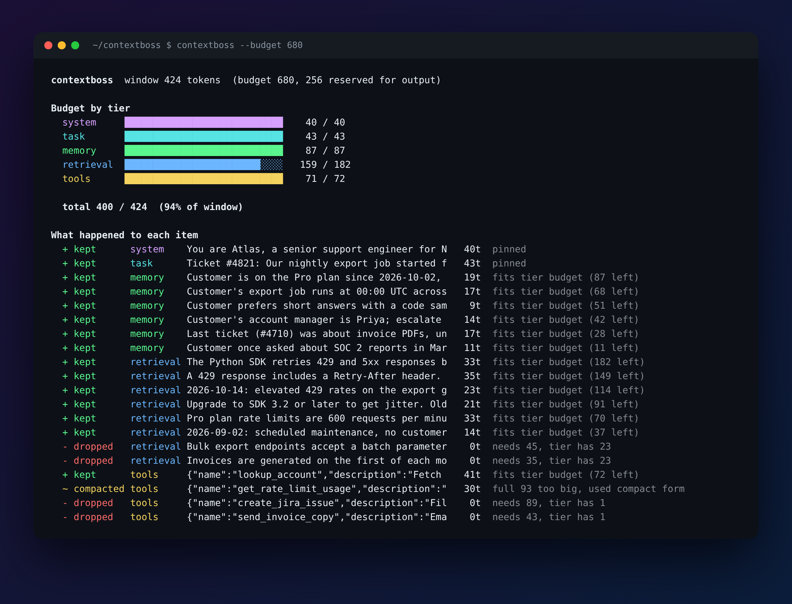
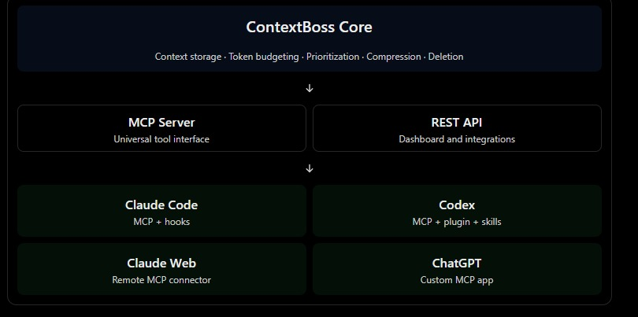

<h1 align="center">contextboss</h1>

<p align="center"><b>Master the context window, don't fight it.</b><br>
Dynamic token budgeting, priority-based context injection, memory + retrieval + tool allocation.</p>

## Run it

```bash
# MCP for Claude Code / Desktop / Codex
pip install contextboss-mcp        # then: contextboss-mcp  (stdio)
contextboss-mcp serve --http       # streamable HTTP for Claude Web / ChatGPT

# REST API + dashboard
pip install contextboss-api
contextboss-api                    # http://127.0.0.1:8787
cd apps/dashboard && npm install && npm run dev

# Or one container
docker compose up                  # API on 127.0.0.1:8787
```

See [ARCHITECTURE.md](ARCHITECTURE.md) for how the pieces fit and
[docs/benchmarks.md](docs/benchmarks.md) for measured results.


<p align="center"></p>

Most agents stuff everything into the prompt and pray. Then the window fills up, something
important gets cut off, and the model starts guessing.

`contextboss` treats the window as a budget. You hand it every candidate block (system prompt,
task, memories, retrieved docs, tool schemas). It decides what goes in, what shrinks, and what
stays out, and tells you why. The result never exceeds the window.

## Quickstart

```bash
pip install -e packages/contextboss-core
contextboss                 # live demo: what got in, what got dropped, why
contextboss --budget 400    # squeeze it and watch the tiers fight
contextboss --show          # also print the final assembled prompt
```

```python
from contextboss import ContextAssembler, MemoryStore, Retriever, ToolSpec

asm = ContextAssembler(budget=8000, output_reserve=1000)
asm.system("You are a careful support engineer.")
asm.task("Why are our exports returning 429?")

memory = MemoryStore()
memory.add("Customer upgraded to Pro on Oct 2", importance=2.0)
asm.load_memory(memory, query="429 export", k=10)

docs = Retriever()
docs.index("rate-limits.md", open("rate-limits.md").read())
asm.load_retrieval(docs, query="429 export", k=10)

asm.tool(ToolSpec("get_usage", "Per-minute request counts for an API key", {"type": "object"}))

ctx = asm.assemble()
print(ctx.render())          # ready to send
print(ctx.total_tokens, "of", ctx.window)
for d in ctx.dropped():
    print(d.item_id, d.reason)
```

## How it works

Tiers, in order of priority:

| Tier | Role | Treatment |
| --- | --- | --- |
| `system` | Who the model is | Pinned. Raises `ContextOverflowError` if it alone can't fit |
| `task` | What to do right now | Pinned. Truncated as a last resort |
| `memory` | Facts about the user and history | Share of the flexible pool, ranked by relevance x importance x recency |
| `retrieval` | Docs and chunks | Share of the flexible pool, ranked by relevance |
| `tools` | Function schemas | Share of the flexible pool, full schema then compact form, never half a schema |

1. **Dynamic token budgeting.** Output tokens are reserved first. System and task are pinned.
   The remaining pool is split across memory, retrieval and tools by weight with a hard cap per
   tier. A tier that needs less gives its unused share to tiers that need more (water-filling).
   See [`budget.py`](src/contextboss/budget.py).
2. **Priority-based injection.** Inside a tier, higher priority goes first. Output is always
   ordered by tier, so the prompt reads `system > task > memory > retrieval > tools`.
3. **Graceful degradation.** An item that doesn't fit gets a second chance as its compact form
   (tools), then as a summary (memory, retrieval), and only then is dropped. Summarizing is a
   plug point: pass any `(text, max_tokens) -> str` as `summarizer=` to use an LLM instead of
   the built-in extractive one.
4. **Spill.** After every tier has been filled, leftover tokens go back to dropped items, in
   tier order. Nothing is wasted.
5. **Overflow prevention.** Real counts via `tiktoken` (heuristic fallback if it isn't
   available), and a final invariant check: `total_tokens <= window`, always.

Every decision is recorded: `ctx.decisions` has the item, action (`included`, `compacted`,
`summarized`, `dropped`), tokens, and the reason. No black box.

## Make it yours

```python
from contextboss import BudgetPolicy, Tier

policy = BudgetPolicy(
    weights={Tier.MEMORY: 0.2, Tier.RETRIEVAL: 0.7, Tier.TOOLS: 0.1},
    caps={Tier.MEMORY: 0.4, Tier.RETRIEVAL: 0.9, Tier.TOOLS: 0.3},
)
asm = ContextAssembler(budget=16000, policy=policy)
```

`MemoryStore` and `Retriever` are small in-process stand-ins (keyword overlap and TF-IDF). Swap
in a vector DB, keep the `(item, score)` shape, and feed the scores in as `priority=`.

## Layout

```
src/contextboss/
  assembler.py   the engine: pin, split, fill, degrade, spill, verify
  budget.py      dynamic per-tier allocation
  summarize.py   pluggable shrinking
  memory.py      memory store with recency decay
  retrieval.py   retrieval stub
  tokenizer.py   tiktoken + fallback
  cli.py demo.py the live demo
tests/           pytest, including the never-overflows property across budgets
```

## Dev

```bash
pip install -e ".[dev]" && pytest
python scripts/make_screenshot.py   # regenerate docs/demo.png (needs Chrome)
```

MIT

## Persistent context

New in 0.2: `ContextManager` adds durable storage around the assembler. Entries carry
namespaces, tags, provenance, pinned flags and full version history, live in SQLite
(WAL + FTS5 search), and deletion is real deletion: the entry, its index rows and its
history all go.

```python
from contextboss import ContextManager

mgr = ContextManager("context.db")          # or ":memory:"
mgr.add("Staging deploys freeze on Fridays", tags=["deploy"], provenance="slack:#eng")
mgr.add("User is on the Pro plan since Oct 2", pinned=True, importance=2.0)

ctx = mgr.assemble("deploy freeze", system="You are a careful support engineer.",
                   task="Why did the Friday deploy fail?", budget=8000)
print(ctx.render())                          # never exceeds the window
mgr.compact(entry_id, target_tokens=100)     # shrink, keeping version history
mgr.delete(entry_id)                         # gone for good
```

## Repository layout

```
packages/contextboss-core   the engine: assembly, budgeting, storage, manager
docs/                       images and design docs
```

The PyPI distribution is `contextboss-core`; the import package stays `contextboss`,
so existing code keeps working.

## Architecture

<p align="center"></p>
